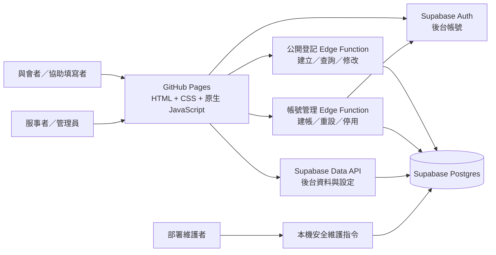

# 2027 國際華語相調特會｜38 會所登記系統架構規劃

> 狀態：上線 MVP 架構基準。依據 [接待與登記表規劃](2027新春華語相調特會_接待與登記表規劃.md) 與 2026-11-02～2026-11-04 的需求討論整理。最新開發順序、部署日與驗收關卡見 [TODO](TODO.md)；核心流程或資料安全驗收未過則延後公開。
>
> 本系統記錄 **38 會所的本地調查與彙整進度**。填寫本系統不等於完成大會正式報名；大會另有匯入系統。

> 2026-11-04 修訂：完整服事者／管理員後台改列本次上線範圍；公開與後台均移除取消／恢復。Turnstile 改於主要功能上線後擴充，現階段使用既有防濫用控制並保留後續整合空間。下文尚未更新的舊描述，以 [TODO](TODO.md) 為準。

## 1. 上線範圍與階段

### 1.1 上線 MVP

- 一人一筆登記。填寫者可以是本人，也可以是任何協助填寫的弟兄姊妹；系統不區分代填者。
- 與會者填姓名，會所固定顯示「38 會所」，區從林森、忠孝、杭州選擇。第一版不收電話、與會者 email。
- 每人回答所有公開開放的聚會、用餐或其他活動，可以全部不參加。可在截止前用查詢碼查看內容，確認或修改後按「儲存」。公開介面不提供取消或恢復操作。
- 查詢碼遺失時，由具權限的服事者在後台依受控程序重設。
- 活動、區、時間表與系統設定由管理員在後台維護，頁面仍從資料庫動態讀取，不寫死於 HTML。
- 用餐費用只用來計算**目前預估金額**。不處理收款、退款或結算。
- 上線 MVP 包含服事者／管理員後台、統計與通用 CSV；不處理住宿接待家庭登記與分配，也不連接大會系統 API。

### 1.2 後台與上線後擴充

- 服事者管理名單、協助修改、處理疑似重複、更新大會匯入進度、查看統計並匯出 CSV。
- 管理員管理服事者帳號、區選項、活動、詳細時間表與本地調查截止時間。
- 管理員查看稽核紀錄。Cloudflare Turnstile 於主要功能上線後新增，屆時仍須在服務端驗證。
- 取得大會系統範本後，再製作可驗證的專用 CSV；通用 CSV 不宣稱可直接匯入。

後台已加入本次必要功能範圍；其他新功能只接受必要的 bug、安全與文字內容修正。公開與後台必要驗收通過後才開放，11/5 為目標日期。

來源需求檔目前在「主日午餐」總覽表中途結束；本文件以已明確討論的決策為準，未把缺失段落推定為功能。

## 2. 系統組成

沿用靜態頁面方式：GitHub Pages 提供 HTML、CSS、原生 JavaScript；瀏覽器使用 Supabase 用戶端連接本案專用的 Supabase Cloud。開發／自動測試與正式環境使用兩個獨立專案，不共用其他專案的資料表、帳號或 RLS 政策。

| 層 | 責任 |
| --- | --- |
| 靜態頁面 | 顯示活動資訊、填表、查詢碼輸入、名單與統計；不保存管理密鑰。 |
| Supabase Auth | 服事者與管理員的登入及密碼雜湊。填表者不建立 Auth 帳號。 |
| Edge Functions | 執行匿名登記操作、驗證查詢碼與基本濫用防護；另由管理員專用函式執行 Auth 帳號管理。未來加入 Turnstile 時在服務端呼叫 Siteverify。 |
| Postgres + RLS | 保存資料、限制各角色可讀寫的表與資料列；權限判斷不依賴頁面是否顯示按鈕。 |
| 本機安全維護指令 | 維護操作由授權人員透過受控流程執行；憑證僅由伺服端安全保存。 |

瀏覽器 runtime 不使用 build step。Node.js 與 npm 只在開發階段執行本機靜態伺服器與 Playwright；Supabase CLI 可用時也用於部署，部署環境無法使用時改由 Dashboard 依版控 SQL 與 Edge Function 原始碼部署。使用仍受支援且已修補的 LTS，套件鎖定精確版本並提交 `package-lock.json`。正式 GitHub Pages 不執行 Node.js server。

`SUPABASE_URL` 與 publishable／anon key 可放在部署後的 `config.js`，因為它們會送到瀏覽器；Supabase secret／service role key 只能放在 Edge Function 的伺服端環境。公開操作與後台權限由服務端和 RLS 驗證。

## 3. 頁面與使用流程

| 頁面 | 主要內容 |
| --- | --- |
| 公開登記頁 | 特會資訊、注意事項、詳細時間表、目前開放的活動、姓名與區、各活動參加／不參加選擇；以 RWD 支援桌機、筆電、平板與手機。 |
| 完成頁 | 只顯示隨機查詢碼，提供複製按鈕與明確保存提醒；流水號保留供內部核對及維護。查詢碼只在建立或重設時顯示。 |
| 查詢／修改頁 | 與公開登記頁同一入口。輸入查詢碼後才回傳該筆登記並顯示修改；流水號和姓名不能單獨取得資料。截止後可查看，不能自行變更。 |
| 後台登入頁 | 服事者輸入帳號與密碼。沒有公開申請帳號頁。 |
| 後台名單與統計 | 依姓名、區、流水號、活動、匯入狀態搜尋；顯示疑似重複、未回覆、目前預估金額；可匯出 CSV。 |
| 後台設定 | 管理員維護活動、詳細時間表、區選項、截止時間與服事者帳號。 |

### 3.1 公開登記

1. 載入特會資訊、詳細時間表、有效區選項與**目前開放**的活動。
2. 填姓名與區；每個當時開放的活動都明確選「參加」或「不參加」，可以全部不參加。未開放的活動不要求回答。
3. Edge Function 驗證輸入、截止時間、honeypot、最短合理填寫時間及 `create_request_id`，在同一筆資料庫交易建立登記與各活動選擇。
4. 公開 API 只回傳一次性顯示的查詢碼，固定流水號留在內部資料。若頁面關閉而未保存查詢碼，上線初期須由部署維護者以安全指令重設。

管理員日後新增活動時，舊登記對新活動為「未回覆」，不會自動當作「不參加」。首次填寫的新登記仍須回答當下所有開放活動。舊登記只查看時可保留未回覆；再次儲存修改時，必須回答當下所有公開活動。

### 3.2 查詢、確認與修改

- 流水號是內部辨識紀錄用的編號，不能作為授權憑證。查詢碼使用 8 字元小寫英數碼，排除 `0`、`o`、`1`、`i`、`l`，由安全亂數產生並確保唯一；舊 5 碼立即失效。資料庫只保存以伺服端秘密值保護的雜湊值。輸入時自動轉小寫並忽略空白。公開查詢與修改在 Edge Function 驗證查詢碼後，僅處理對應的一筆登記。
- 公開查詢與修改加入服務端濫用防護與一致錯誤回應；具體偵測條件與維運程序不公開。
- 建立成功後以 `sessionStorage` 將一次性查詢碼傳至 `success.html`，不得放在 URL。完成頁提供複製與保存提醒；使用者尚未確認已保存時，離開頁面須提醒。關閉分頁後暫存內容消失。
- 截止前可查看先前填寫內容，確認或修改後以單一「儲存」按鈕送出。公開介面不提供取消或恢復操作；既有狀態欄位暫留供歷史資料相容。截止後僅可查看。
- 查詢碼遺失時，上線初期由部署維護者使用安全指令依流水號重設。指令從本機安全讀取 secret，產生新碼、使舊碼立即失效並寫入 audit。完整後台完成後，再由服事者以姓名、區搜尋並透過既有的實體聯繫方式確認當事人；同名同區須進一步核對紀錄。
- 不提供以姓名、區或流水號直接找回查詢碼的公開 API；查詢碼不放在網址或 CSV 中。

### 3.3 大會匯入進度

這是 38 會所的**內部作業狀態**，並非大會報名成功狀態：

| 狀態 | 定義 |
| --- | --- |
| 待匯入 | 新建立且尚未由服事者確認匯入大會系統。 |
| 已匯入 | 服事者確認這筆資料已在大會系統處理，並手動標記。單純按下 CSV 匯出不會改成此狀態。 |
| 需重新匯入 | 已匯入後，姓名、區或活動選擇變動；或管理員變更該人參加的活動名稱、時間、開放狀態。 |

僅新增活動而舊登記尚未回答時，不改動舊登記的匯入狀態；補選後才判斷是否需重新匯入。單純調整本地預估費用不改匯入狀態。

### 3.4 疑似重複與退出

同名同區仍允許送出。後台標示「可能重複」，服事者可確認為不同人，或保留正確紀錄並把另一筆標為「重複作廢」。重複作廢紀錄保留供後台查核，不計入有效人數、預估費用與有效名單 CSV。本次不提供取消或恢復登記。

## 4. 資料模型草案

資料表與欄位名稱是實作建議；開發時可依 SQL migration 調整命名，但須保留此處的資料語意與權限。

| 資料表 | 主要欄位 | 用途與約束 |
| --- | --- | --- |
| `districts` | `id`, `name`, `is_active`, `sort_order` | 初始三區：林森、忠孝、杭州。管理員可新增、改名、停用；已使用的區不硬刪，保留舊登記關聯。 |
| `site_settings` | `id`, `event_name`, `venue`, `address`, `registration_deadline_at`, `is_registration_open`, `updated_at` | 單筆系統設定。`is_registration_open` 必須為 `true` 才能登記；截止時間為空代表無期限，有設定時才檢查是否截止。時間使用帶時區時間戳，畫面以台灣時間顯示。 |
| `program_items` | `id`, `event_date`, `start_time`, `end_time`, `title`, `note`, `sort_order`, `is_visible` | 詳細聚會時間表。可記錄第一至第五堂、展覽、擘餅等；不直接產生報名選擇。未確定時間可留空並顯示待定說明。 |
| `activities` | `id`, `category`, `title`, `starts_at`, `ends_at`, `venue`, `address`, `map_url`, `description`, `fee_amount`, `is_published`, `sort_order`, `created_at`, `updated_at` | 可選擇的聚會、用餐、其他活動。管理員可任意新增；費用以 NT$ 整數記錄，`NULL` 代表未設定費用，`0` 代表免費。已有選擇紀錄的活動只能停用，不能刪除。 |
| `registrations` | `id`, `serial_no`, `create_request_id`, `full_name`, `district_id`, `query_code_hash`, `record_status`, `import_status`, `duplicate_review_status`, `created_at`, `updated_at`, `imported_at`, `imported_by` | 一人一筆。`id` 是內部 UUID；`serial_no` 由資料庫序列產生，畫面格式為 `活動流水號起始值`，超過四位時自然延長。`create_request_id` 用來防止同一送出請求因重試而建立兩筆；姓名與區不設唯一鍵。 |
| `registration_choices` | `registration_id`, `activity_id`, `attending`, `updated_at` | 複合主鍵避免同人對同一活動有多筆選擇。`true`＝參加，`false`＝不參加，**沒有資料列**＝未回覆。 |
| `staff_profiles` | `auth_user_id`, `username`, `display_name`, `district_id`, `role`, `is_active`, `must_change_password`, `created_at` | 後台帳號；角色只允許 `admin`／`staff`。帳號名稱不分大小寫且唯一。停用帳號後，資料庫查詢立即失去授權。 |
| `audit_events` | `id`, `actor_type`, `actor_user_id`, `action`, `target_type`, `target_id`, `before_data`, `after_data`, `created_at` | Append-only 稽核紀錄。保存公開建立、修改及後台異動；不得保存密碼、查詢碼、查詢碼雜湊或防機器人憑證。只有 `admin` 可讀，瀏覽器角色不得新增、修改或刪除。 |

可由查詢計算的參加人數、未回覆人數與預估金額不另存一份。統計預設只計入有效登記與目前公開的活動；停用活動的舊選擇仍可在後台歷史紀錄查看。管理員停用活動前，畫面應提示受影響的登記人數，並讓服事者檢查只參加該活動的人。

### 4.1 初始活動資料

| 類型 | 活動 | 初始費用 | 備註 |
| --- | --- | ---: | --- |
| 聚會 | 02/20 華語特會第一天 | 未設定 |  |
| 聚會 | 02/21 華語特會第二天，含擘餅 | 未設定 |  |
| 聚會 | 02/21 青年大會 | 未設定 | 時間與地點尚待確認 |
| 用餐 | 02/20 週六午餐 | NT$250／人 | 規劃值 |
| 用餐 | 02/20 週六晚餐 | NT$250／人 | 規劃值 |
| 用餐 | 02/21 主日午餐 | NT$250／人 | 規劃值 |
| 其他 | 02/21 主日晚間帶菜愛筵 | 未設定 | 是否舉行待確認 |

Q43 已確認：建立下列全部活動；正式環境的未確認項目保持未公開。測試環境可暫時公開用餐及愛筵供填寫測試，並明確標示暫定資訊；青年大會和主日晚間愛筵不能因已列在規劃檔就宣稱時間、地點或舉辦已確定。

## 5. 角色與權限

MVP 包含公開流程與服事者／管理員後台。下表是本次上線須驗收的權限；不得用公開 API 或把 service role key 放入瀏覽器取代。

| 操作 | 公開訪客 | 服事者 `staff` | 管理員 `admin` |
| --- | :---: | :---: | :---: |
| 看公開活動與時間表 | ✓ | ✓ | ✓ |
| 建立登記 | 截止前，經 Edge Function 服務端驗證 | ✓ | ✓ |
| 查看／修改自己的登記 | 憑查詢碼；修改限截止前 | ✓ | ✓ |
| 查看、修改全體登記與重設查詢碼 |  | ✓ | ✓ |
| 處理重複、標記匯入狀態、看統計、匯出 CSV |  | ✓ | ✓ |
| 管理活動、時間表、區、截止時間 |  |  | ✓ |
| 建立、重設、停用後台帳號 |  |  | ✓ |

所有登入者都可查看全體名單，不依區隔離。`staff_profiles` 的角色與啟用狀態由資料庫／Edge Function 判斷。`authenticated` 身分本身**不代表**服事者權限；沒有啟用的 profile 不得讀寫名單。公開訪客不得直接讀取 `registrations`、`registration_choices`、`staff_profiles` 或查詢碼雜湊。

### 5.1 後台帳號

- 管理員在後台指定帳號名稱、姓名、所屬區與角色。系統產生一次性初始密碼，管理員以既有安全聯繫方式私下交付。首次登入須更改密碼；忘記密碼由管理員重設，舊密碼不可查看。
- 第一位管理員由部署者在 Supabase Dashboard／受控初始化程序建立。關閉公開 Auth signup；不提供服事者自行申請或管理員公開註冊頁。
- 帳號管理 Edge Function 驗證呼叫者的 Auth 身分、`staff_profiles.role = admin` 與啟用狀態，才呼叫 Auth 管理 API。禁止停用最後一位有效管理員。
- 登入畫面使用**帳號／密碼**。參考專案把帳號轉成 Auth 內部使用的 email 形式再登入；本案可沿用此對應概念，但須先在新的 Supabase 專案驗證內部識別格式及管理員建帳、登入、改密碼、重設流程。這個內部識別不作為可收信地址，系統第一版不寄信。
- `must_change_password` 必須在服務端權限檢查中生效。初始密碼登入者只能進入改密碼流程；成功改密碼後才開放名單權限。

## 6. 服務端安全界線

1. 對瀏覽器可呼叫的每張表啟用 RLS，明確設定資料表 grants 與各操作的 policy；`authenticated` 身分不能單獨取得管理權限。公開可讀的資訊只限活動、時間表與有效區選項。
2. 公開登記 Edge Function 驗證輸入長度、選項是否有效、截止時間與活動開放狀態。新增須驗證 honeypot、最短合理填寫時間及 `create_request_id`；查詢失敗回傳一致訊息。查詢碼驗證須具備服務端濫用防護與一致錯誤回應；營運控制與偵測細節不公開。前端驗證只為操作便利，不是權限依據。
3. 查詢碼在服務端產生，只保存以伺服端秘密值保護的雜湊值；比對與重設只在服務端執行。第一版不保存 IP 或 IP 雜湊。登入密碼交由 Supabase Auth 保存，不自行儲存明文或另建密碼欄。
4. 建立登記與活動選擇、修改與匯入狀態更新，須透過資料庫交易保持一致。`create_request_id` 設唯一約束，防止同一請求因網路重試產生兩筆；若首次回應遺失，不能從伺服端取回原查詢碼，須由授權服事者依受控流程重設。
5. 管理員專用 Edge Function 使用的 secret key 只存伺服端。`config.js`、HTML、GitHub Actions 發布成品中不得出現密鑰。主要功能上線後再加入 Cloudflare Turnstile；屆時前端取得 token、服務端呼叫 Siteverify，並以新 migration 調整建立登記限額、重新驗收防濫用。未完成前，本次公開流程不得依賴 Turnstile 設定。
6. 針對匿名、一般已登入但未授權、停用服事者、服事者、管理員，驗證允許與拒絕的存取情境；特別測試不能用別人的流水號、姓名或區讀寫資料。
7. 建立、修改及匯入狀態更新透過受控 RPC／Edge Function，在資料庫交易內完成並寫入 `audit_events`。Audit 只允許新增，不允許一般角色修改或刪除。

## 7. 後台統計與 CSV

- 按區、活動計算參加／不參加／未回覆人數。重複作廢不計入有效人數；既有測試資料若有已取消狀態也不計入。
- 顯示待匯入、已匯入、需重新匯入的人數，以及以**目前活動費用**計算的預估總額。費用調整後重新計算，不保存舊費用快照。
- 第一版 CSV 為「每人一列、每個目前公開活動一欄」，另有流水號、姓名、區、內部匯入狀態；活動欄輸出參加／不參加／未回覆。查詢碼與雜湊永不匯出。CSV 用 UTF-8 BOM 以利常見試算表開啟，並處理可能被試算表當作公式的文字欄位。
- 匯出 CSV 不自動標記「已匯入」。大會系統格式尚未取得，取得範本後另做欄位對應與匯出驗證。

## 8. 部署與營運

- 分支流程為 feature branch → `測試分支` 測試環境 → `main` 正式環境。GitHub Pages 正式站只部署 `main` 的網站成品目錄，不得把 SQL、測試、規劃文件、`node_modules` 或 secrets 放入 artifact。
- 本機靜態頁面直接連遠端開發／測試 Supabase Cloud；正式環境使用另一個 Supabase 專案。兩個專案都由同一組版控中的 migration／seed 建立；依核准的部署程序套用已版控的資料庫與函式變更，保留部署紀錄。
- GitHub Actions 產生僅含公開設定的 `config.js`。開發專案的本機設定檔不得進版控；service role key、資料庫密碼及 Edge Function secrets 不得出現在前端設定或 GitHub Pages 成品。
- 11/5 前完成可重複執行的資料庫與 Playwright 測試；GitHub Actions 完整 CI 可延後。Playwright 自動測 Desktop Chromium、Desktop WebKit、Mobile Chrome 與 Mobile Safari 模擬。
- 11/5 公開前部署正式環境並完成封閉驗收，使用實際 iPhone、iPad 或 Mac Safari 完成 smoke test。Playwright WebKit 不取代實際 Safari 驗收。
- 正式開放前設定 `is_registration_open`、確認三個區與公開活動，並完整測試建立、查詢、儲存、錯誤查詢碼、截止規則、RLS 拒絕案例及查詢碼重設指令。
- 後台帳號改由管理員建立，不寄驗證信、申請通知或密碼重設信；第一版**不依賴 Mailgun／Resend，也不需要寄信網域**。
- 正式開放前依核准的資料生命週期程序處理驗收資料，完成備份、範圍核對與授權確認；不在公開文件記載資料清理操作細節。
- 特會結束、匯入與核對完成後，由管理員先匯出備份，再手動清除姓名與登記資料。**清除日期由 38 會所決定**；本文件不自行設定期限。清除前須明確預覽資料範圍並保留可還原的備份。

## 9. 上線前待確認與技術驗證

| 項目 | 目前狀態 | 對實作的影響 |
| --- | --- | --- |
| 本地調查截止日期 | 待公告 | 由管理員填入；未設定時不得誤顯示已確定日期。 |
| 青年大會時間、地點及愛筵是否舉行 | 待公告 | 初始活動須標示暫定或保持未公開，待管理員確認。 |
| 餐廳地圖連結與部分用餐時間 | 待補 | 活動欄位允許暫時留空。 |
| 大會系統匯入範本 | 未提供 | 第一版只提供通用 CSV；不能聲稱可直接匯入。 |
| 活動後資料清除日期 | 由 38 會所決定 | 確定營運保留期限後再執行手動清除。 |
| 內部帳號識別格式 | 尚未在新 Supabase 專案驗證 | 完整後台實作前測試建帳、帳號／密碼登入、改密碼與重設。若 Auth 拒絕不收信的內部識別格式，須改用經確認可用的識別方式，不能以公開註冊或關閉權限檢查繞過。 |
| Cloudflare Turnstile 啟用時間 | 主要功能上線後擴充 | 防機器人服務憑證依環境隔離並由伺服端驗證；本次先驗收現有防濫用控制。 |
| 上線功能凍結（Q42） | 已確認 | 只接受必要的 bug、安全與文字內容修正，避免完整後台阻擋 MVP。 |
| 初始活動建立策略（Q43） | 已確認 | 建立全部規劃活動，未確認項目保持未公開。 |

## 10. 架構選擇

本案採用靜態頁面部署、Supabase Edge Functions、Postgres 與 RLS，並依一人一筆、私密查詢碼與 append-only audit 設計資料模型及授權。Supabase Auth 與兩種後台角色納入本次上線範圍。

頁面上的角色顯示與操作開關只影響介面；實際權限由資料庫 RLS 與 Edge Function 驗證。

上線版優先完成公開垂直切片與可復原的營運流程；後續功能沿用相同資料模型與安全界線擴充，不能以公開 service key、關閉 RLS 或直接修改正式資料取代尚未完成的後台。

### 技術參考

- [Supabase：Row Level Security](https://supabase.com/docs/guides/database/postgres/row-level-security)
- [Supabase：資料庫函式與權限](https://supabase.com/docs/guides/database/functions)
- [Supabase：Auth 管理員建帳](https://supabase.com/docs/reference/javascript/auth-admin-createuser)
- [Supabase：Edge Function 驗證](https://supabase.com/docs/guides/functions/auth)
